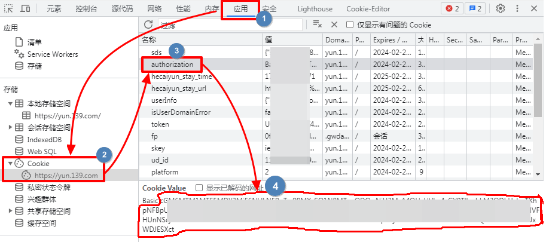
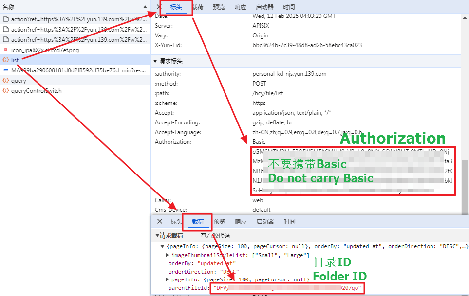

<div align="center">
  <h1>cloudpan-auto-save</h1>
  <p>移动云盘（139）自动追更系统 · WebUI 管理 · Telegram 机器人 · Emby / AList / STRM 联动</p>
  <p>
    
    
    
    
  </p>
</div>

> 本项目是一套专注于 **中国移动云盘（139）** 及多网盘生态的影视追更、智能转存与媒体资产自动化治理系统。
> 基于 Vue 3 + TypeScript 现代全栈架构全面重构，提供流畅的 WebUI、139 原生 302 直链 STRM 生成引擎、Emby/Jellyfin 双向联动、网盘深度死链巡检与多版本画质去重治理。

## 目录

- [项目状态](#项目状态)
- [功能特点](#功能特点)
- [快速开始](#快速开始)
- [使用说明](#使用说明)
- [Telegram 机器人命令](#telegram-机器人命令)
- [环境变量](#环境变量)
- [注意事项](#注意事项)
- [安全警告](#安全警告)
- [界面预览](#界面预览)
- [特别声明](#特别声明)
- [License](#license)

## 项目状态

项目目前处于 Beta 阶段，核心流程可用，但仍可能在边界场景出现问题。

- 可能存在边界 Bug（超大文件、特殊字符文件名、网络抖动等）
- 建议先用非核心数据小规模验证后再正式投入使用
- 欢迎提交 [Issue](../../issues) 或 [Pull Request](../../pulls)

## 功能特点

### Telegram 频道流式监控与智能媒体转存

- **多频道池化全局集中控制**：统一配置总开关、多频道监听源池化、一处配置全局生效；
- **关键词二次分流路由引擎**：默认落盘目录 + 简单关键词二次分流规则组（如命中 `4K` 自动路由至 `/4K电影`，命中 `动漫` 进 `/Anime`）；
- **免登录无感流式嗅探**：支持任意 Telegram 公开频道（`https://t.me/s/xxx` 或 `@xxx`），定时抓取推文并智能嗅探 139 移动云盘分享链接与提取码，免申请 TG API，0 封号风险；
- **TMDB 规则可视化工作台与 AST 正则编译器**：海报卡片一键添加监控项，自动编译聚合正则表达式，内置推文沙箱实时演练（Live Preview）；
- **全站统一路径中枢与 0 字节连根修剪**：以「媒体整理」作为全站唯一路径事实源，统一管理「源暂存区 ➔ 目标媒体库」，频道监控与单链追更全面自动复用；转存归档完毕后自动执行 `sweepEmptyFolders` 自底向上修剪空目录，恢复纯净 0 字节暂存区；
- **139 云盘助手 2.8.x 点分规范建树整理**：彻底废除旧式简陋字符串/Jinja模板，全面对齐助手结构化块级点分渲染器（`buildStandardTargetName`），输出洗版友好点分文件名与规范媒体目录树；
- **免下载 Range 二进制探针真实辨伪**：仅当检测到 UDF 2.50 BDMV 原盘结构才准标 `BluRay`，伪装成 ISO 的单视频流严格剥除 `BluRay` 虚高标签，守护质量评分真实性；
- **双重黑名单全链路防御**：文本字面黑名单（前置 0 网盘请求拦截） + TMDB 二级分类黑名单（识别归属国产剧等黑名单分类时立即分类熔断，整批暂存文件移入回收站并修剪空目录，媒体库 0 污染）；
- **广告与推广说明垃圾过滤**：自动识别 `ISO文件如何使用.png` 等说明文件移入 139 回收站，绝不并入媒体库；
- **伴随字幕同名匹配与归档**：同集外挂字幕文件随视频同步重命名归档；
- **事件驱动与联动刷新**：转存入库完毕后自动广播 `taskComplete` 事件，联动 OpenList/AList 缓存刷新、Emby 刮削通知与多渠道消息推送。

### 自动化任务（单链追更）

- **极速一键提交**：新建任务默认 100% 自动静默汇入系统统一暂存区并参与自动刮削入库，零多余目录弹窗与选择器，1 秒极速建单；
- **纯文本意图调度**：告别生硬手写 Cron 表达式，内置急速（30m）、推荐（2h）、平缓（6h）、每日（1d）等快捷意图胶囊；
- 定时自动检查分享链接更新
- 失败任务自动重试（可配置次数和间隔）
- 任务过期自动完成（默认连续 10 天无更新自动标记完成，适配周更剧集）
- 支持目标目录缺失时自动创建（139）

### 文件与命名

- 支持目录树选择保存路径
- 支持常用目录管理
- 支持批量重命名：正则、Jinja2 模板、顺序重命名

### 媒体联动、格式清洗与网盘清理

- **影视规范整理与自动化刮削中心 (MediaScrapeService · MoviePilot v3 工业级范式)**：
  - **全自动归档全景大盘**：指标卡片（整理总数、电影数、剧集数、失败数）+ TMDB 海报网格 + ⚪原文件名 vs 🔵2.8.x 标准点分物理路径双行对比 + 单条快捷撤回；
  - **139 网盘文件管理穿梭机**：原生多账号网盘文件浏览器、多级目录面包屑穿梭、一键规范整理与移入回收站（`batchTrash` 资产安全兜底）；
  - **双分栏手动整理沙箱**：左侧 TMDB 联想补全与参数纠偏，右侧 0 物理写入实时推演规范路径与点分清洗报告，源目录与目标目录相同一票熔断；
  - **物理隔离强互斥**：用户手动指定源目录（待整理）与目标目录（规范归档），前后端强制校验两目录绝不相同且目标不可为源子树；
  - **跨地区官方译名证据链与五级防漏检索**：联动 TMDB Translations 官方中文全区域多模态检索（港/台/陆/新异名对照，如《间谍过家家》vs《间谍家家酒》），内置年份剥离、类型交叉、简繁对偶、副标题拆解五级降级防漏重试链，支持显式 TMDB ID / 纯数字直查直通；
  - **宁缺毋滥与免打扰待处理箱**：存疑文件坚决在源目录原地不动保留；处理箱人工纠偏后自动持久化 `ScrapeBinding`，终身自愈免重复干预；
  - **WAL 写前日志与 LIFO 原子撤回**：每次整理前落盘写前操作日志，支持单条与整批一键无损搬回源目录原路径并恢复原文件名。
- **RecognitionEngine 深度媒体与格式清洗**：支持动漫别名标准化、中英双语去噪、繁简转换（`toSimplified`）、伪装幽灵后缀剥离（`.mkv.jpg` -> `.mkv`）、非法字符全角化、截断乱码自愈、综艺日期提取、MoviePilot 二级分类与 TMDB 评分加权
- **零下载 ISO 原盘规格嗅探 (IsoProbeService)**：免下载 50GB 镜像，纯 JS HTTP Range 仅读 512KB~2MB（内存 <5MB），秒级定位 UDF 2.50 蓝光主影片 `.m2ts` 或 DVD 主 `.VOB` 流，回填真实介质规格
- **全局违规失效文件检测与清理 (CloudMaintenanceService)**：6 层规则深度探测违规死链，安全分批移入回收站，原目录复查确认
- **TMDB 剧集缺集巡检与一键清理 (EpisodeInspectionService)**：智能穿透网盘剧集目录比对 TMDB 官方官方季播集数，实时精准呈现收录缺更矩阵；支持「一键删除缺集」批量清理与单剧/单季精准移入 139 网盘回收站，绝不物理硬删
- **安全空文件夹修剪 (sweepEmptyFolders)**：白名单安全防护，先行清理系统垃圾，自底向上递归修剪纯空目录
- **PanSou 盘搜资源自动愈合**：分享链接失效/过期/超限时，自动检索 PanSou 最新 139 链接并按 5 级画质规格（制作组 > Remux > 分辨率 > 杜比/HDR > 体积）智能择优替换
- **全双工 Webhook 统一联动 (SmartStrm / Emby)**：
  - **正向入库通知 (Outbound)**：转存完成且 STRM 生成后，自动向 SmartStrm 派发 `cs_strm` 请求（生成 302 直链播放 STRM 并通知 Emby），或向通用 Webhook 广播 `transfer.completed` 事件
  - **反向删除同步网盘 (Inbound)**：监听 Emby `library.deleted` / `item.delete` 事件，逆向剥离挂载前缀，精准将 139 网盘文件或目录移入回收站
  - **绝对安全红线白名单**：根目录与核心受保护路径（`/`、`/媒体库` 等）严格熔断拦截，绝不硬删，确保用户资产绝对安全
- STRM 文件自动生成
- AList / OpenList 目录缓存刷新

### AI 智能识别与深度纠偏助手 (OpenAI 协议兼容)

- **广泛兼容主流大模型协议**：原生兼容 OpenAI (`gpt-4o-mini`)、DeepSeek (`deepseek-chat`)、火山引擎豆包 (Volcengine Ark)、月之暗面 Kimi、阿里通义千问、SiliconFlow、本地 Ollama (`http://localhost:11434/v1`) 等任何遵循 OpenAI `/v1/chat/completions` 协议的大模型服务；
- **智能兜底与辅助纠偏策略 (`fallback`)**：优先使用零延迟的本地规则引擎与 TMDB 严格匹配；仅当规则无法解析、片名存疑、或推文/文件名混入「丨」等网盘防封干扰字符时，自动调用大模型进行高准确度语义抽取与纠偏；
- **结构化元数据提取与防封字符清洗**：精准清洗防封符号（如「仙丨逆」->「仙逆」），自动识别并抽离官方权威中文名、英文原名、上映年份、影视类型、季/集数、技术规格（分辨率/编码/动态范围）与 MoviePilot 标准二级分类；
- **10 分钟 TTL 内存缓存防重复计费**：同一段推文或文件名在 10 分钟内复用缓存解析结果，杜绝高频批量整理时的 Token 重复消耗；
- **WebUI 在线测试沙盒与网络代理支持**：系统设置页内置连通性测试与即时交互沙盒，可实时输入复杂推文验证解析结果，并无缝接入网络代理隔离分流。

### 通知与集成

- Telegram 机器人远程管理任务
- 企业微信 / Telegram / Bark / WxPusher 推送
- WebUI 可视化管理（含暗黑模式）
- API Key 保护的 REST API

### 跨号秒传与直链离线下载

- **139 账号间跨号秒传 (PC 纯协议)**：
  - 基于 139 移动云盘 PC 官方接口 `/hcy/file/create`，实现账号间毫秒级极速跨号转存；
  - 智能特征码比对与目标目录并发锁，杜绝并发竞态产生双胞胎同名文件夹；
  - 目标目录已有同名同大小文件自动标记跳过；
  - 可选秒传成功后自动将源文件移入源账号回收站（`batchTrash`），绝对遵循 0 物理硬删安全红线。
- **跨网盘直链离线下载 (首批 123 网盘)**：
  - 从 139 提取官方 CDN 高速下载直链，云端提交至目标网盘离线，不占用服务器本地网络与带宽；
  - 规范驱动抽象解耦（`BaseHttpOfflineAdapter`），为后续接入 115、迅雷等直链离线网盘奠定统一架构契约；
  - 5252 自适应二分拆批，遇到服务端阈值自动对半递归提交并动态学习账号安全批次；
  - 智能卡死停滞检测与失效直链自动刷新重推，系统级级联熔断器保护账号免受频控拦截。

## 快速开始

### 方式一：Docker Run（推荐）

```bash
docker run -d \
  -v $(pwd)/data:/home/data \
  -v $(pwd)/strm:/home/strm \
  -p 3001:3000 \
  --restart unless-stopped \
  --name cloudpan-auto-save \
  -e TZ=Asia/Shanghai \
  azheng0108/cloudpan-auto-save:latest
```

> `data` 和 `strm` 目录会自动创建在执行命令的当前目录下。
> 
> 💡 **宿主机权限与 PUID/PGID 自愈说明**：
> - 镜像内置 `docker-entrypoint` 权限自愈机制，容器启动时会自动检测挂载目录并自适应修复可写权限；
> - 如需指定特定用户身份，可传入 `-e PUID=1000 -e PGID=1000`；若遇只读外部挂载设备亦可传 `--user root` 运行。

### 方式二：Docker Compose

```yaml
version: '3.8'

services:
  cloudpan-auto-save:
    image: azheng0108/cloudpan-auto-save:latest
    container_name: cloudpan-auto-save
    restart: unless-stopped
    ports:
      - "3001:3000"
    volumes:
      - ./data:/home/data
      - ./strm:/home/strm
    environment:
      - TZ=Asia/Shanghai
```

启动命令：

```bash
docker compose up -d
```

访问地址：`http://localhost:3001`

默认账号密码：`admin / admin`（首次登录后请立即修改）

## 使用说明

### 1. 账号配置（139）

- 支持账号密码登录与 Authorization 登录
- 当前主流程聚焦移动云盘（139）

Authorization 获取步骤：

1. 打开 [yun.139.com](https://yun.139.com) 并登录
2. 按 `F12` 打开开发者工具，进入 `Network`
3. 过滤 `Fetch/XHR`，刷新页面
4. 找到任一 `yun.139.com` 请求，复制请求头 `Authorization` 值（通常为 `Basic xxxxx`）
5. 在系统中新增账号时填入 Cookie 输入框





提示：Authorization 模式通常更稳定，Cookie 失效后需重新抓取。

### 2. 任务管理

创建任务时可配置：

- 账号
- 分享链接（含访问码）
- 保存目录
- 总集数（可选）
- 文件名匹配规则（可选）

支持能力：

- 批量任务创建（自动识别目录结构）
- 手动执行任务
- 删除任务（可选同步删除云盘文件）
- 任务失败重试与定时检查

### 3. 批量重命名

支持三种模式：

- 正则重命名（可持续用于后续更新）
- Jinja2 模板重命名（自动识别标题、年份、集号）
- 顺序重命名（一次性处理）

### 4. 本地 STRM 文件生成与 139 CDN 原生 302 直链播放

系统内置工业级 STRM 生成引擎，实现影视媒体从自动整理到 Emby / Jellyfin / Infuse 直链播放的全流程闭环：

- **100% 镜像媒体库层级**：本地 STRM 目录完整复刻整理后的媒体库（如 `剧集/国漫/片名 (年份) {tmdb-id}/Season 01/xxx.strm`），并支持自动剥离顶层目标目录名，直接挂载给 Emby 作为媒体库根路径；
- **139 官方 CDN 原生 302 直链 (`/api/strm/stream/:fileId`)**：客户端播放时，系统实时换取 139 官方 CDN 高速直链并 302 重定向，**0 本地服务器中转流量与内存占用**，满带宽直连串流，无需部署额外的反代组件；
- **整理自动联动**：在「媒体整理配置」开启「整理入库后自动生成 STRM 文件」后，无论是 Telegram 频道监控自动整理还是手动整理入库，归档落盘时自动在本地生成同结构 `.strm` 文件，并支持推送统计汇报。

### 5. 媒体服务器与 Webhook 联动 (SmartStrm / Emby)

系统支持全双工 Webhook 总线，实现与 [SmartStrm](https://github.com/Cp0204/SmartStrm) 及 Emby 的深度闭环联动：

#### ① 正向入库通知 (转存完成 -> 触发 SmartStrm / 媒体服)
- **原理**：139 云盘转存完成且 STRM 生成后，自动向下游派发 Webhook；
- **SmartStrm 规范 (默认)**：发送 `event: "cs_strm"`，携带任务名、云盘路径与文件列表，通知 SmartStrm 生成 302 直链播放 STRM 并入库 Emby；
- **通用规范**：发送 `event: "transfer.completed"`，供 MoviePilot、飞牛 NAS 或自定义自动化脚本消费；
- **测试出站推送**：在 Web 界面可一键点击【测试出站推送】验证下游接口连通性。

#### ② 反向删除同步网盘 (Emby 删片 -> 139 网盘自动清理)
- **原理**：在 Emby Webhooks 插件中添加本系统的 Webhook 接收地址，当在 Emby 中删除电影或剧集时，自动同步清理 139 网盘内的对应文件；
- **配置步骤**：
  1. 在 Web 管理界面「设置」->「媒体服务器与 Webhook 联动」中勾选「启用 Emby 删除同步网盘」；
  2. 点击【复制地址】获取完整接收 URL（含安全 Token，如 `http://<IP>:3000/api/webhook/emby?token=xxxxxx`）；
  3. 打开 Emby 控制台 ->「Webhooks」插件 -> 新增 Webhook，填入上述地址，事件勾选「媒体库内容删除 (library.deleted)」；
  4. 在设置页填入「Emby 媒体库挂载前缀」（如 `/media` 或 `/mnt/139`），系统将据此反向逆推 139 网盘相对路径；
- **资产安全第一**：
  - **白名单熔断**：根目录 `/` 与核心目录（如 `/媒体库`）绝对受保护，即使 Emby 发送误删请求也会被 100% 强制拦截；
  - **回收站保护**：删除操作统一移入 139 网盘回收站（`batchTrash`），绝不硬删除，杜绝误操作风险。

### 5. 网盘清理与存储治理中心 (Web 界面 & 定时清理)

系统在 Web 界面左侧导航栏提供了专属的 **【网盘清理】** 独立管理中心，无需配置 Telegram 机器人即可直接可视化操作：

- **6 层深度探针违规死链巡检与清理**：
  - **全盘/指定目录巡检**：精准排查黑名单特征哈希、`hw-warning` 官方占位缩略图/预览、审核拦截码 `auditResult=3`、审核描述文本敏感词与服务端封禁标记；
  - **一键安全清理**：支持多选/全选批量移入 139 网盘回收站（绝非不可恢复的物理硬删除），并在网盘原目录复查确认文件已彻底清除。
- **安全空文件夹自底向上修剪**：
  - **后序遍历递归修剪**：优先处理最深层叶子空目录，自动清理 `.DS_Store`、`Thumbs.db`、`desktop.ini`、`@eaDir` 等系统垃圾文件；
  - **白名单安全保护**：根目录 `/` 及 `/媒体库`、`/暂存区` 等系统核心目录受永久保护，绝对防止误删。
- **0 刮削多版本影视资产智能去重**：
  - **资产指纹聚类**：纯算法秒级提取剧集季集（SxxEyy）与电影年份指纹，跨格式、繁简统一聚类；
  - **5 级画质策略裁决**：按「发布组优先级 -> 蓝光Remux -> 分辨率4K>1080p -> 杜比视界/HDR -> 文件体积」自动推选最佳保留版本（Keeper）与待淘汰版本（Losers）；
  - **直观卡片对比与预演**：清晰对比各版本压制规格与预估释放空间，支持试运行（Dry Run）与一键批量移入回收站。
- **自动化定时维护与多渠道通知**：
  - **独立 Cron 调度**：支持分别为违规巡检（默认 `0 3 * * 0`）、空目录修剪（默认 `0 4 * * 0`）、多版本去重（默认 `0 5 * * 0`）配置定时轮询；
  - **安全防误删机制**：默认仅巡检并推送提醒报告；开启「自动移入回收站」开关后即可全自动静默清理；
  - **多渠道消息提醒**：任务完成后自动向 Telegram、企业微信、Bark、WxPusher、PushPlus、自定义 Webhook 发送明细报告。## 环境变量

| 变量 | 默认值 | 说明 |
| --- | --- | --- |
| `NODE_ENV` | `production` | 运行环境 |
| `PORT` | `3000` | 容器内监听端口 |
| `TZ` | `Asia/Shanghai` | 时区 |
| `DEBUG` | `false` | 是否开启调试日志 |
| `ALLOWED_ORIGINS` | 空 | CORS 白名单，逗号分隔 |
| `PANSOU_URL` | `http://127.0.0.1:8080` | PanSou 盘搜服务地址 |
| `PANSOU_TOKEN` | 空 | PanSou API Token（可选） |
| `AUTO_HEAL_ENABLED` | `true` | 是否启用分享链接失效自动盘搜愈合 |
| `AUTO_HEAL_MAX_ATTEMPTS` | `3` | 单任务链接失效最大自愈替换次数 |

示例：

```bash
ALLOWED_ORIGINS=http://localhost:3001,https://your-domain.com
```

## 注意事项

- 更新目录可移动但不建议删除，否则任务可能失败
- 数据库存储在挂载目录 `data` 下，请做好备份
- 媒体后缀配置会影响文件过滤和计数
- STRM 生成依赖正确的访问前缀
- Emby / AList 功能依赖正确的服务地址与密钥配置
- 旧版本升级后若 TG 常用目录异常，建议清空后重新添加

## 安全警告

本项目涉及账号凭据与敏感数据，请严格遵守以下原则：

- 务必私有化部署，不要直接暴露公网
- 不要使用第三方搭建实例
- 不要向他人泄露账号、Cookie、Token
- 建议使用反向代理并启用 HTTPS

## 界面预览

<details>
<summary>点击展开截图预览</summary>

### Web 界面

<div style="display: flex; flex-wrap: wrap; gap: 20px; justify-content: flex-start;">
  <div style="flex: 0 0 calc(50% - 10px);">
    <h4>任务管理</h4>
    
  </div>
  <div style="flex: 0 0 calc(50% - 10px);">
    <h4>资源搜索</h4>
    
  </div>
  <div style="flex: 0 0 calc(50% - 10px);">
    <h4>媒体库</h4>
    
  </div>
  <div style="flex: 0 0 calc(50% - 10px);">
    <h4>系统日志</h4>
    
  </div>
</div>

### Telegram 机器人界面

<div style="display: flex; flex-wrap: wrap; gap: 20px; justify-content: flex-start;">
  <div style="flex: 0 0 calc(50% - 10px);">
    <h4>帮助信息</h4>
    
    <p>通过 /help 查看所有可用命令。</p>
  </div>
  <div style="flex: 0 0 calc(50% - 10px);">
    <h4>资源搜索</h4>
    
    <p>使用 /search_cs 搜索资源。</p>
  </div>
  <div style="flex: 0 0 calc(50% - 10px);">
    <h4>创建任务</h4>
    
    <p>发送分享链接或编号可直接创建任务。</p>
  </div>
  <div style="flex: 0 0 calc(50% - 10px);">
    <h4>任务列表</h4>
    
    <p>使用 /tasks 查看当前任务列表。</p>
  </div>
</div>

</details>

## 特别声明


1. 本项目仅供学习交流，请勿用于非法用途。
2. 本项目当前版本提供移动云盘（139）转存能力，接口来自各平台官方接口。
3. 由使用本项目产生的风险与后果由用户自行承担。

## License

MIT


