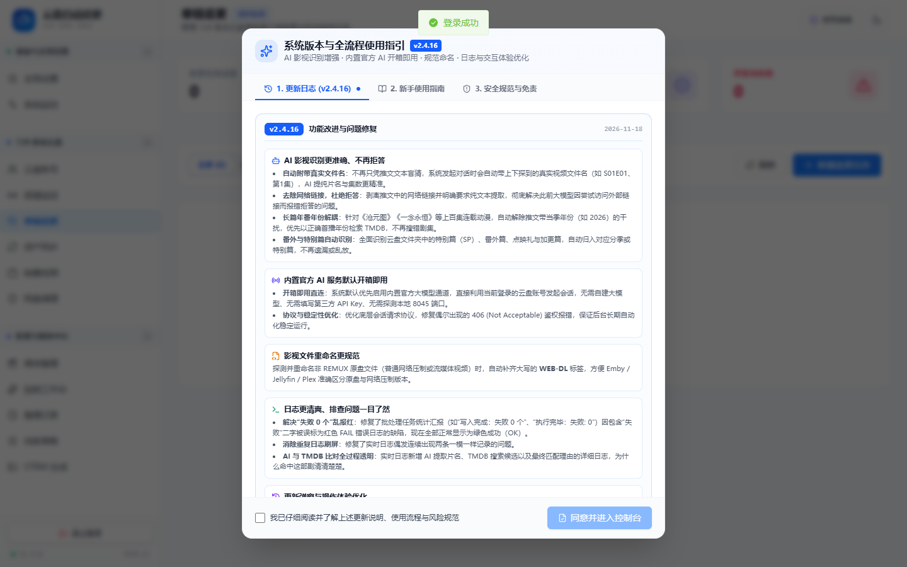
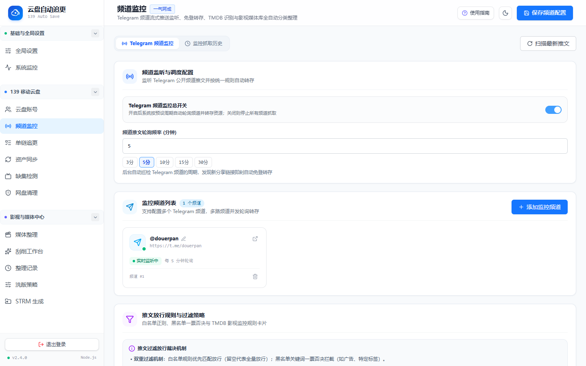
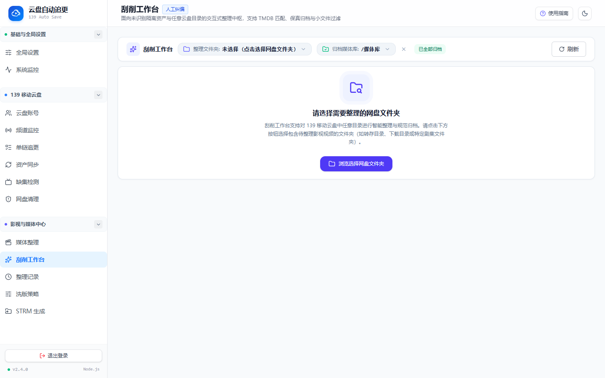
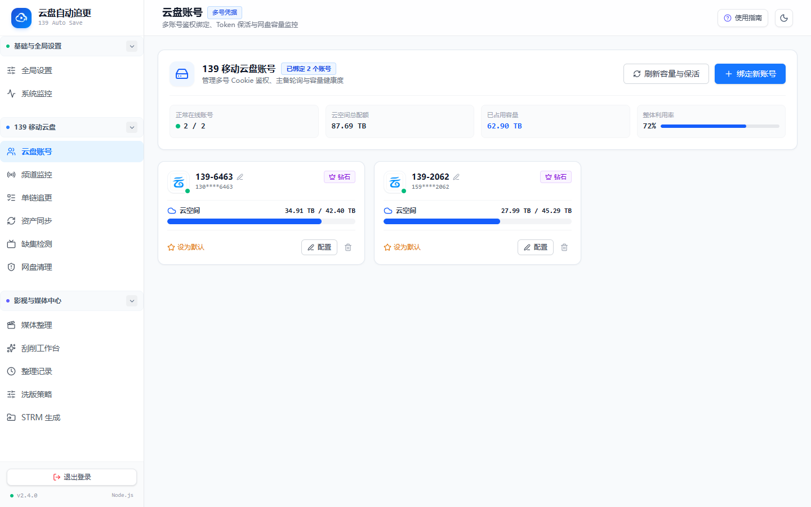
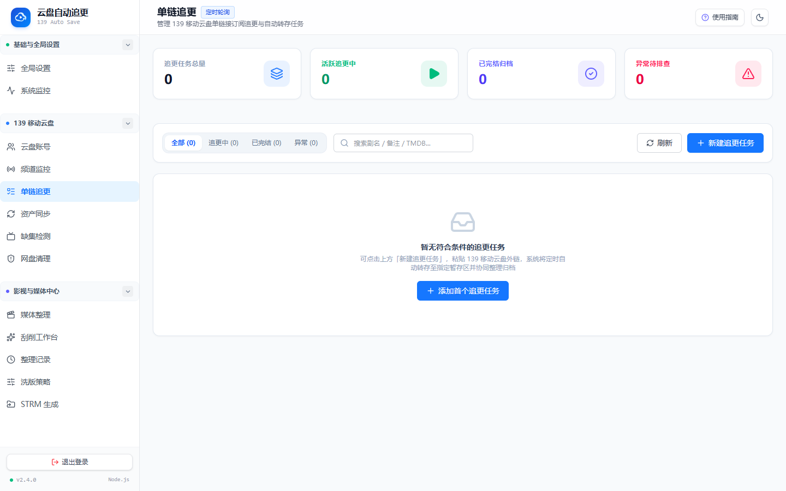
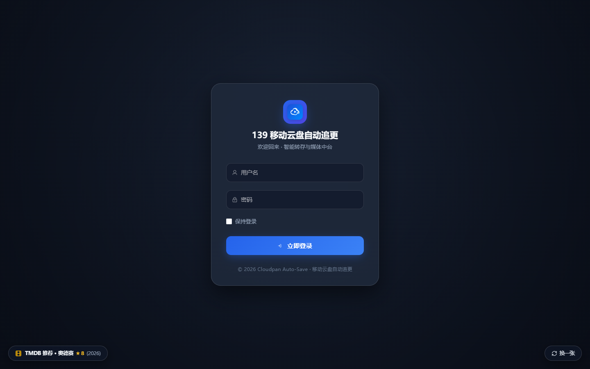
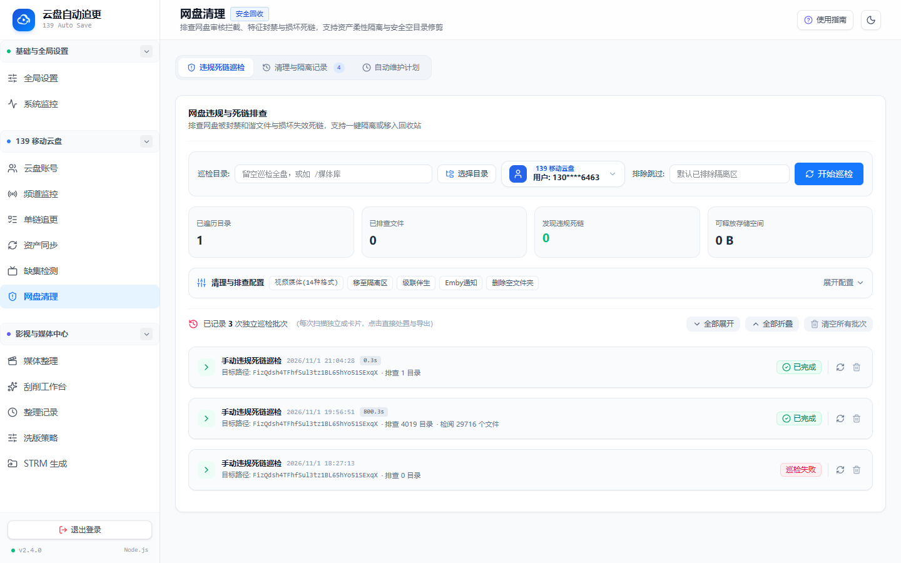
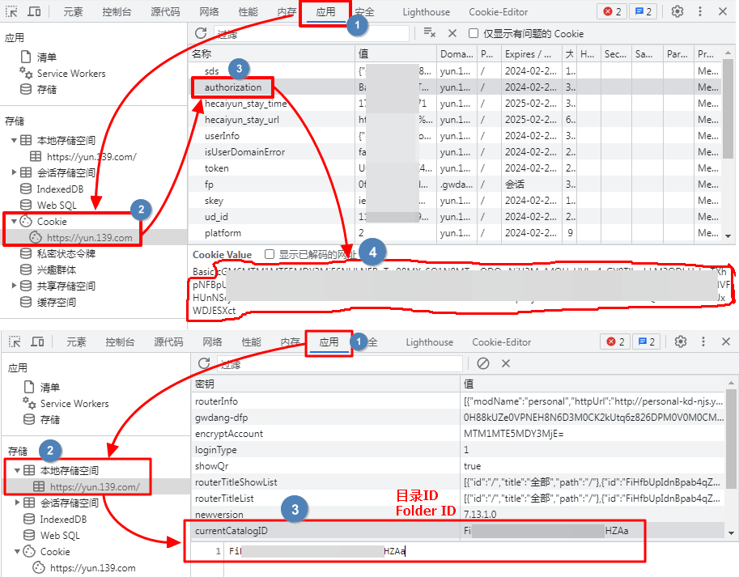
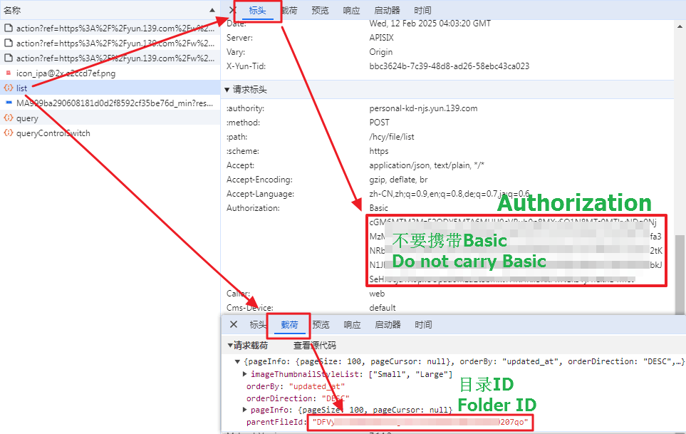

# cloudpan-auto-save

139 云盘自动化追更与影视媒体整理系统 · 现代 WebUI 管理 · Telegram 频道监控 · Emby / Jellyfin 302 直链播放

> 本项目是一套专为 **139 云盘** 用户打造的影视自动追更、智能转存归档与媒体资产管理系统。
> 前端采用 Vue 3 单页架构，后端内置 139 官方 302 直链 STRM 生成引擎、TMDB 影视智能识别归档、网盘死链巡检与多版本去重治理。

---

## 目录

- [这是什么系统？](#这是什么系统)
- [系统界面预览](#系统界面预览)
- [核心功能说明](#核心功能说明)
- [安装部署方式](#安装部署方式)
  - [方式一：Docker 命令行运行（推荐）](#方式一docker-命令行运行推荐)
  - [方式二：Docker Compose 部署（推荐）](#方式二docker-compose-部署推荐)
  - [方式三：源码本地运行（开发者）](#方式三源码本地运行开发者)
- [新手五步快速上手](#新手五步快速上手)
- [139 凭据与目录 ID 获取教程（手动抓包）](#139-凭据与目录-id-获取教程手动抓包)
- [常用环境变量](#常用环境变量)
- [安全提示与使用原则](#安全提示与使用原则)
- [开源协议](#开源协议)

---

## 这是什么系统？

平时用 139 云盘看剧看电影，通常会遇到这些麻烦事：
1. **追更太繁琐**：每周更新都要手动去点分享链接转存，容易遗漏；
2. **文件名杂乱无章**：转存回来的视频文件名带满推广字眼、压制组代号、乱码字符，放到 Emby / Jellyfin / Plex 里根本无法正确刮削出海报和演员信息；
3. **本地磁盘不够用**：动辄几十 GB 的 4K 电影或长篇电视剧，全下载到本地硬盘很快爆盘，而且费时耗电。

本项目就是为了解决这些痛点而开发的自动化工具：
只需填入追更链接或关注的 Telegram 频道，系统便会自动检测更新并转存到网盘。随后自动结合真实视频文件名与 TMDB 权威影视库进行比对，规范重命名并归档分季。最后在本地自动生成 `.strm` 文件，播放器直接通过 139 官方 CDN 高速串流播放，**本地 0 硬盘占用、0 服务器带宽消耗**。

---

## 系统界面预览

系统前端基于 Vue 3 单页响应式架构打造，提供现代美观的操作界面与实时的任务反馈：

| 现代化登录界面 | 版本更新与新手安全引导 |
| :---: | :---: |
|  |  |

| Telegram 频道自动监控 | TMDB 影视智能整理与归档 |
| :---: | :---: |
|  |  |

| 139 多账号管理与快捷扫码 | 自动化追更任务调度 |
| :---: | :---: |
|  |  |

| 全局网络与通知设置 | 系统运维与 SSE 实时日志流 |
| :---: | :---: |
|  |  |

---

## 核心功能说明

### 1. 自动化追更与频道监控转存
- **单链定时追更**：添加分享链接后，系统按设定频率（如每 2 小时、每天）自动检查分享目录是否有新集数发布，有新文件自动转存。
- **Telegram 频道自动转存**：支持监听 Telegram 公开频道推文，自动嗅探推文中的 139 云盘分享链接与提取码并自动转存，无需自行申请 TG API Key。
- **多账号支持与自动保活**：支持添加多个云盘账号，手机 App 扫码即可快捷绑定，系统会自动定期保活刷新登录凭据，免去繁琐抓包。

### 2. TMDB 智能影视识别与规范归档
- **真实文件名提纯**：识别时不仅看推文标题，还会自动下探读取转存文件夹内的真实视频文件名（如 S01E01、第1集），有效避免因推文标题简短而识别错误。
- **防拒答与去外部链接**：彻底剥离推文中的外部网络链接，明确限定纯文本语义清洗，杜绝大模型因尝试联网而报错拒答。
- **长篇年番年份解耦**：针对连载上百集的动漫年番（如《沧元图》《一念永恒》等），自动剥离推文中的当季年份（如 2026），准确以首播年份检索 TMDB，不再搜错剧集。
- **番外与特别篇自动识别**：支持网盘文件夹中的特别篇（SP）、番外篇、点映礼与加更篇，自动识别并分流归档，不再遗漏或乱放。
- **非原盘自动规范 WEB-DL 标签**：探测并重命名非 REMUX 文件时，自动补齐大写的 WEB-DL 标签，方便媒体库精准区分原盘与流媒体压制版。

### 3. 139 官方 302 直链播放（STRM）
- **本地零体积镜像**：根据归档后的媒体库目录结构，在本地生成体积仅几百字节的 `.strm` 文件，挂载给 Emby、Jellyfin 或 Infuse 使用。
- **官方 CDN 高速串流**：客户端播放时，系统实时解析 139 官方高速 CDN 直链并通过 302 重定向播放，本地服务器仅做指令中转，不消耗宿主机存储与播放带宽。

### 4. 网盘资产与存储健康治理
- **违规死链巡检与清理**：自动探测因审核拦截或失效的死链文件，支持批量清理。
- **自底向上空目录修剪**：文件整理转移后，自动递归修剪各级空文件夹并清理系统残留垃圾文件。
- **多版本画质智能去重**：同一部剧集存在多个版本时，按画质策略（如 4K 优于 1080p）智能标记最佳版本与待淘汰版本，支持一键清理冗余文件。
- **绝对安全红线**：所有清理删除操作默认全部移入 139 云盘回收站，绝不执行物理硬删除，任何时候都可在网盘官方回收站中手动一键还原。

### 5. 消息通知推送
- 支持在转存成功、整理完成或巡检异常时，自动推送通知至 Telegram 机器人、企业微信、Bark、WxPusher 等多个平台。

---

## 安装部署方式

系统提供了多种部署方式，建议优先使用 Docker 部署，开箱即用。

### 方式一：Docker 命令行运行（推荐）

打开终端，直接运行以下命令启动容器：

```bash
docker run -d \
  --name cloudpan-auto-save \
  --restart unless-stopped \
  -p 3000:3000 \
  -v /your/local/data:/home/data \
  -v /your/local/strm:/home/strm \
  -e TZ=Asia/Shanghai \
  -e PUID=0 \
  -e PGID=0 \
  azheng0108/cloudpan-auto-save:latest
```

**参数说明**：
- `-p 3000:3000`：WebUI 访问端口，可按需修改宿主机端口（例如 `-p 3001:3000`）。
- `-v /your/local/data:/home/data`：**必需**。数据存储目录，存放系统数据库、登录凭据与配置文件。请将 `/your/local/data` 替换为你本机的实际路径。
- `-v /your/local/strm:/home/strm`：**可选**。STRM 文件输出目录，若需生成 STRM 给 Emby 播放，请挂载此目录。
- `azheng0108/cloudpan-auto-save:latest`：默认使用稳定正式版镜像。若需尝鲜最新功能，可替换为 `beta` 标签。

---

### 方式二：Docker Compose 部署（推荐）

在你的服务器或 NAS 上创建一个项目文件夹，并在其中新建 `docker-compose.yml` 文件：

```yaml
version: '3.8'

services:
  cloudpan-auto-save:
    image: azheng0108/cloudpan-auto-save:latest
    container_name: cloudpan-auto-save
    restart: unless-stopped
    ports:
      - "3000:3000"
    volumes:
      - ./data:/home/data
      - ./strm:/home/strm
    environment:
      - NODE_ENV=production
      - TZ=Asia/Shanghai
      - PUID=0
      - PGID=0
    logging:
      driver: "json-file"
      options:
        max-size: "10m"
        max-file: "3"
```

在包含该文件的目录下执行以下命令启动服务：

```bash
# 启动容器
docker compose up -d

# 查看运行日志
docker compose logs -f

# 后续更新镜像
docker compose pull && docker compose up -d
```

---

### 方式三：源码本地运行（开发者）

如果你想在本地开发、修改代码或直接在 Node.js 环境中运行：

**环境要求**：
- Node.js 20.x 或更高版本
- Git
- Yarn 与 npm

**步骤说明**：

1. 克隆代码仓库：
```bash
git clone -b dev https://github.com/azheng0108/cloudpan-auto-save.git
cd cloudpan-auto-save
```

2. 安装后端与前端依赖：
```bash
yarn install
npm --prefix frontend install
```

3. 编译构建前端静态资源：
```bash
npm --prefix frontend run build
```

4. 启动后端主程序：
```bash
node src/index.js
```

服务默认在 `http://localhost:3000` 启动运行。

---

## 新手五步快速上手

部署完成后，按照以下步骤即可快速跑通整套自动化流程：

### 第一步：访问控制台并修改初始密码
1. 在浏览器中打开 `http://你的服务器IP:3000`；
2. 输入默认管理员账号密码登录：
   - 默认用户名：`admin`
   - 默认密码：`admin`
3. 登录后系统会弹出当前版本的使用指南与安全提示，阅读后确认进入；
4. 进入系统后，请第一时间在「基础与全局设置」中修改初始密码。

### 第二步：添加 139 云盘账号
1. 点击左侧导航栏的「139 云盘」➔「账号管理」；
2. 点击「新增账号」，系统支持两种添加方式：
   - **方式 A（强烈推荐）：扫码快捷登录**
     选择扫码模式，打开手机端「中国移动云盘」App 或微信扫描屏幕上的二维码完成授权，凭据自动绑定并全天候自动保活，无需手动抓包；
   - **方式 B：手动录入 Authorization 凭据**
     如需无手机手动登录或批量导入，可选择手动模式填入凭据，具体抓包步骤参见下文 [139 凭据与目录 ID 获取教程（手动抓包）](#139-凭据与目录-id-获取教程手动抓包)。
3. 账号绑定成功后，设置为「主力账号」作为默认转存主体。

### 第三步：配置媒体整理路径
1. 点击左侧导航栏的「媒体整理」➔「整理配置」；
2. 设置两个核心目录：
   - **待整理目录（源目录）**：例如网盘中的 `/临时转存` 或 `/Downloads`；
   - **影视媒体库（目标目录）**：例如网盘中的 `/媒体库`；
   > 提示：直接在页面中输入网盘文件夹路径即可；如需通过底层目录 ID 定位，可参考 [获取目录ID教程](#139-凭据与目录-id-获取教程手动抓包)。
3. 开启「自动整理」开关，并设定扫描整理时间间隔（例如每 30 分钟一次）。

### 第四步：添加追更任务或开启频道监控
- **添加单个追更任务**：点击「追更任务」➔「新建任务」，填入网盘分享链接与访问码，系统会自动创建定时任务并按周期跟进更新。
- **开启 Telegram 频道监控**：点击「频道监控」，添加目标公开频道链接，系统会自动抓取推文并嗅探最新影视链接转存入库。

### 第五步：挂载 STRM 目录到 Emby / Jellyfin
1. 在「媒体整理」中开启「整理入库后自动生成 STRM」；
2. 将宿主机挂载的 `strm` 目录路径添加为 Emby 或 Jellyfin 的媒体库文件夹；
3. 媒体服务器扫库后即可看到标准的海报、演职员与分季信息，点击播放即可享受官方直链秒开播放。

---

## 139 凭据与目录 ID 获取教程（手动抓包）

在添加云盘账号或配置媒体目录时，除了系统自带的「手机 App 扫码一键登录」和「目录树直接选择」之外，如果你需要手动录入凭据或确认网盘文件夹的真实 ID，可通过浏览器开发者工具（F12）快速获取。

系统支持以下两种方式获取凭据与目录 ID：

---

### 方法一：通过「应用 (Application)」存储面板获取（推荐，最省事）

用电脑浏览器（Chrome / Edge 等）打开并登录 [139 移动云盘网页版](https://yun.139.com)，按键盘 `F12` 打开开发者工具，切换到顶部的 **「应用」(Application)** 选项卡：

1. **获取 Authorization（登录凭据）**：
   - 在左侧菜单展开 **存储 ➔ Cookie**，点击 `https://yun.139.com/`；
   - 在右侧列表中找到名称为 `authorization` 的条目；
   - 点击该条目，在下方完整复制其值（Value）。
2. **获取 目录ID（Folder ID）**：
   - 在网盘页面点击进入你要查看的目标文件夹；
   - 在左侧菜单展开 **存储 ➔ 本地存储空间 (Local Storage)**，点击 `https://yun.139.com/`；
   - 在右侧键值列表中找到 `currentCatalogID`，其对应的值即为当前文件夹的唯一目录 ID（根目录通常为 `/`）。

| 存储面板获取 Authorization 与 目录ID |
| :---: |
|  |

---

### 方法二：通过「网络 (Network)」请求面板获取（标准抓包）

在 [139 移动云盘网页版](https://yun.139.com) 中按 `F12` 打开开发者工具，切换到 **「网络」(Network)** 选项卡：

1. 刷新一下页面，或在网盘中随意点击一个文件夹；
2. 在网络请求列表中找到名为 `list` 的请求（URL 形如 `/hcy/file/list`）：
   - **获取 Authorization**：点击 `list` 请求 ➔ 切换到 **「标头」(Headers)** ➔ 展开「请求标头 (Request Headers)」➔ 找到 `Authorization` 字段。
     > **注意：** 复制时**不要携带 `Basic ` 前缀**，只需复制后面的 Base64 字符串即可（系统也已内置兼容自动过滤）。
   - **获取 目录ID（Folder ID）**：在同一个 `list` 请求中 ➔ 切换到 **「载荷」(Payload)** ➔ 查看请求载荷中的 `parentFileId`，其字符串即为当前目录在移动云盘后台的真实目录 ID。

| 网络面板获取 Authorization 与 目录ID |
| :---: |
|  |

---

## 常用环境变量

| 环境变量名 | 默认值 | 作用说明 |
| :--- | :--- | :--- |
| `PORT` | `3000` | 后端服务监听端口 |
| `NODE_ENV` | `production` | 运行环境（`production` / `development`） |
| `TZ` | `Asia/Shanghai` | 系统时区，保证定时任务时间准确 |
| `PUID` | `0` | 容器内运行用户的 UID（用于适配 NAS 文件权限） |
| `PGID` | `0` | 容器内运行用户的 GID（用于适配 NAS 文件权限） |
| `ALLOWED_ORIGINS` | 空 | CORS 跨域白名单，多个域名用英文逗号分隔 |

---

## 安全提示与使用原则

1. **私有化独立部署**：本系统涉及个人网盘账号凭据，请务必在家庭局域网、NAS 或个人独享 VPS 上部署，**严禁使用任何第三方公开搭建的实例**。
2. **公网访问保护**：若需在公网环境下远程访问，强烈建议配置反向代理（如 Nginx / NPM）并开启 HTTPS 证书加密，避免明文传输密码。
3. **资产防误删保护**：系统在网盘清理、去重与整理时严格遵循「0 物理硬删」原则，所有移除操作仅移入网盘回收站，如遇异常可随时在官方回收站中还原。
4. **合理设置频率**：建议保持适度的监控与巡检间隔（通常 15~60 分钟），避免短时间内发起高频突发请求引起网盘服务端风控。

---

## 开源协议

本项目基于 MIT License 开源，仅供个人技术研究、网络学习及私人数据归档使用。
